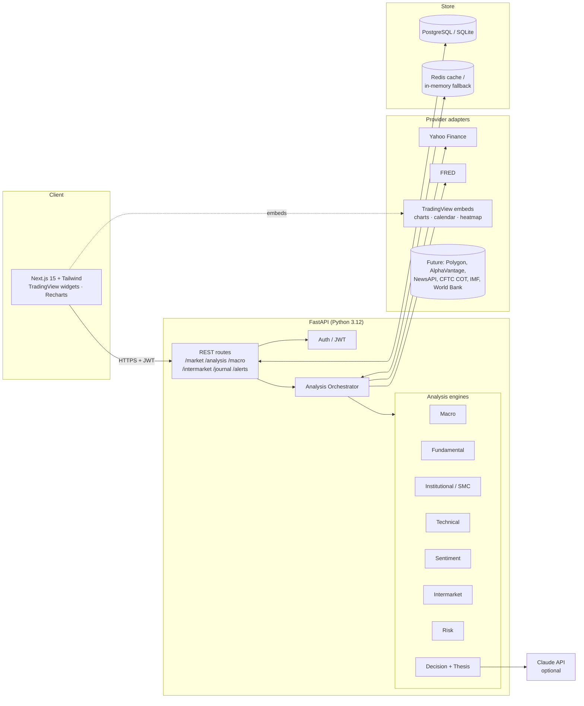
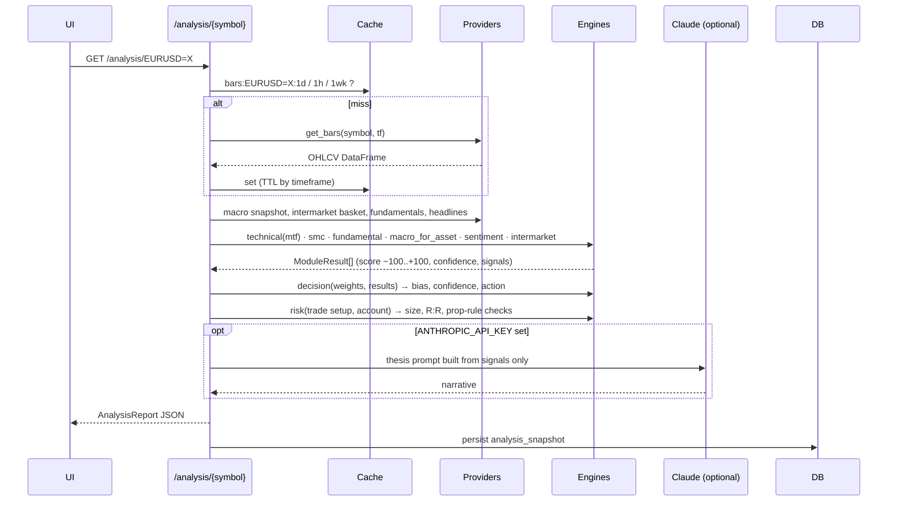
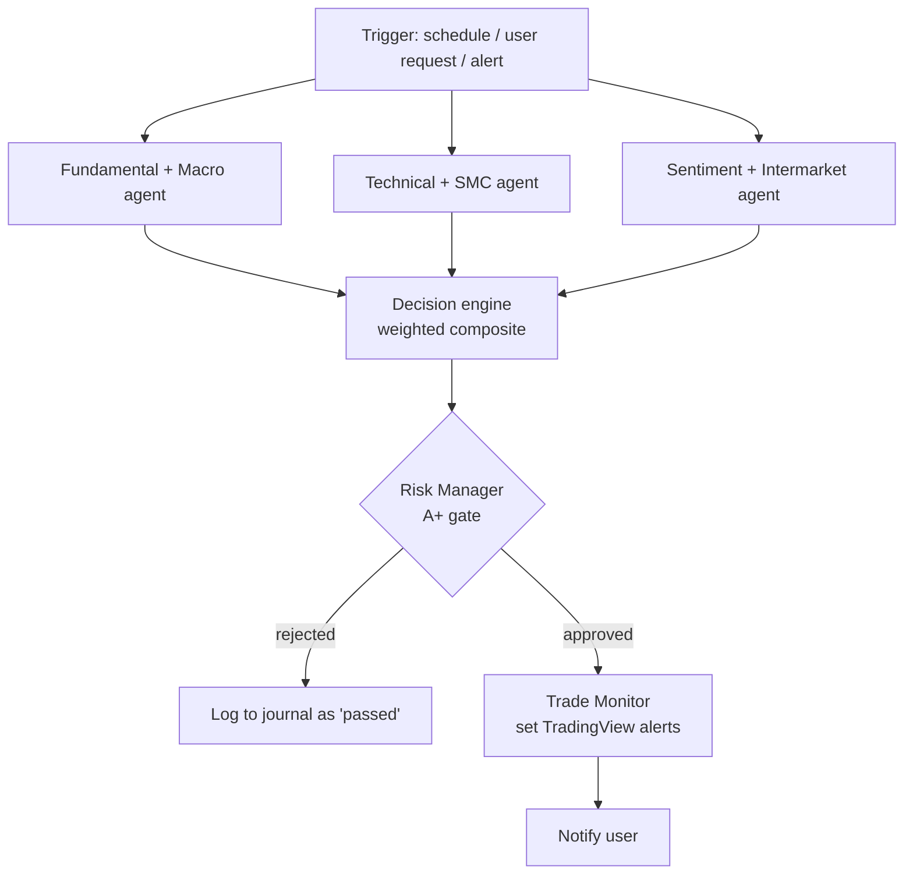

# Financial Intelligence Platform (FIP) — Architecture Blueprint

Scope of this document: the full target system, plus exactly what the MVP in this repository implements. Where the MVP takes a shortcut, it says so.

> **Not financial advice.** Every score this platform produces is a model output built from public data and heuristics. It is a research aid, not a recommendation.

---

## 1. Design principles

| Principle | What it means here |
|---|---|
| **Engines are pure functions** | Each analysis engine takes data frames / dicts in and returns a typed result out. No I/O inside engines → unit-testable on synthetic data, reusable in batch jobs. |
| **Providers are adapters** | Every data source sits behind one `MarketDataProvider` / `MacroProvider` interface. Swapping Yahoo for Polygon is a config change, not a rewrite. |
| **Graceful degradation** | If a module has no data for an asset class (e.g. stock fundamentals for EURUSD), it returns `available=false` and the decision engine renormalises the weights instead of inventing a score. |
| **Explainability over magic** | Every score carries the list of `signals` that produced it. The AI thesis is written *from* those signals; it never generates numbers itself. |
| **Local-first, cloud-ready** | Runs on one laptop with `docker compose up`. The same containers deploy to Kubernetes unchanged. |

---

## 2. System architecture



### Service boundaries (target)

| Service | MVP | Target |
|---|---|---|
| `api` (FastAPI) | ✅ single process | Horizontally scaled behind ALB |
| `ingest-worker` | ❌ (on-demand fetch + cache) | Celery/Arq workers on schedules: EOD bars, FRED releases, COT weekly, news every 5 min |
| `stream-gateway` (Node.js) | ❌ | WebSocket fan-out of live quotes from Polygon/broker feeds |
| `ai-service` | ✅ inside api (`engines/thesis.py`) | Separate service with RAG over news + filings (pgvector) |
| `alert-worker` | ✅ evaluated on request | Background loop evaluating alerts every minute; push via email/Telegram |

Node.js is only justified for the streaming gateway; the MVP has no paid real-time feed, so it is deferred rather than stubbed.

---

## 3. Data flow — one asset analysis



---

## 4. Module specifications

All modules return the same contract:

```python
ModuleResult(
  module: str, available: bool,
  score: float,        # −100 (strong bearish) .. +100 (strong bullish)
  confidence: float,   # 0..1 — data coverage × signal agreement
  label: str,          # Strong Bearish | Bearish | Neutral | Bullish | Strong Bullish
  signals: list[Signal(name, value, impact, note)],
  details: dict
)
```

Labels: `|score| < 15` Neutral, `15–50` Bullish/Bearish, `> 50` Strong.

### 4.1 Macro engine (25%)
- **Inputs (FRED):** CPI (CPIAUCSL), Core PCE, PPI, unemployment (UNRATE), payrolls (PAYEMS), retail sales (RSAFS), industrial production, business inventories (BUSINV), Fed funds (DFF), 2y/10y/3m yields, 10y breakevens, HY OAS, Fed balance sheet (WALCL), TGA (WTREGEN), reverse repo (RRPONTSYD), Sahm-rule indicator.
- **Outputs:**
  - *Inflation direction*: 3-month annualised vs 12-month CPI/PCE → Rising / Falling / Stable.
  - *Growth momentum*: payroll 3m avg, retail sales and IP YoY.
  - *Recession probability*: logistic blend of 10y–3m curve (Estrella–Mishkin form), Sahm indicator and HY credit spreads. Labelled as a model estimate.
  - *Global liquidity score*: net Fed liquidity = WALCL − TGA − RRP, 13-week change z-scored.
  - *Macro bias* per asset: regime (growth ↑/↓ × inflation ↑/↓) mapped to asset sensitivities (e.g. USD-quote pairs, gold vs real yields, equities vs liquidity).
- **Central banks:** MVP tracks Fed from FRED; ECB/BoE/BoJ/SNB/RBA/BoC/RBNZ/PBoC policy rates are held in a config table (`central_banks.yaml`) updated manually or by the target-state ingest worker, and used for FX rate differentials.

### 4.2 Microeconomic engine
- Sector rotation from the 11 SPDR sector ETFs: 1m/3m/6m relative strength vs SPY, ranked.
- Industry outlook = sector RS trend + breadth (share of members above 50-dma, target state).
- MVP: sector rankings + rotation phase classification (early/mid/late cycle leadership).

### 4.3 Fundamental engine (20%)
| Asset class | Signals |
|---|---|
| Stocks | revenue growth, EPS growth, margins, FCF yield, ROE, debt/equity, forward P/E vs sector, PEG |
| Forex | policy-rate differential, inflation divergence (config table + FRED), trade/current account (target: IMF/World Bank) |
| Commodities | seasonality (average month-of-year return over 10y of bars), term-structure and inventories (target: EIA, LME) |
| Indices / crypto | earnings-yield vs 10y (indices), N/A for crypto |

Produces **bull / base / bear** cases: the base case follows the dominant signals; bull and bear cases list which signals would have to flip, with ATR-based price ranges.

### 4.4 Institutional / Smart Money engine (20%)
**Honesty note:** true order flow (footprint, depth, dealer positioning) needs paid Level-2/tick data. From OHLCV the engine detects the *price signatures* SMC traders use:
- **Swing structure** (fractal pivots) → HH/HL/LH/LL, **BOS** and **CHoCH**.
- **Fair value gaps**: 3-candle imbalances, tracked until mitigated.
- **Order blocks**: last opposite candle before a displacement move that broke structure.
- **Liquidity pools**: clusters of equal highs/lows (within 0.1 × ATR).
- **Liquidity sweeps / stop hunts**: wick through a prior swing high/low with close back inside.
- **Accumulation / distribution**: Chaikin A/D and OBV slope vs price slope (divergence).
- **Premium / discount**: price position within the current dealing range.
- **Probability matrix**: historical frequency, on the same series, of continuation after the current structure state (counted, not assumed).
- Target state: CFTC Commitments of Traders (free weekly) for FX, gold, oil, indices.

### 4.5 Technical engine (15%)
Multi-timeframe (1W, 1D, 1H): EMA 20/50/200 trend stack, ADX, RSI(14), MACD(12,26,9), ATR(14), session VWAP (intraday) / anchored VWAP, volume profile (POC, value area 70%), Fibonacci retracement of the last swing, pivot-based support/resistance clusters.
**Trade setup:** entry at nearest confluence level in bias direction, stop beyond structure ± 0.5 ATR, targets at next S/R and 2R/3R; R:R computed.

### 4.6 Sentiment engine (10%)
- MVP: headlines from Yahoo Finance news, scored with a finance lexicon (Loughran–McDonald style) with negation handling; analyst recommendation mean for stocks.
- Target: NewsAPI + RSS, central bank statement hawk/dove classifier, earnings-call transcripts via LLM with RAG; social sentiment where licensed.

### 4.7 Intermarket engine (10%)
Basket: DXY, Gold, Silver, WTI, US10Y, VIX, S&P 500, Nasdaq 100, Bitcoin.
- Rolling 60-day correlation matrix of daily returns (yields as changes, not returns).
- Lead/lag: cross-correlation at lags −5..+5 days; the lag with max |ρ| reported.
- Market driver identification: first principal component loading + which asset explains most variance of the target over 60d (regression R²).
- Regime: risk-on / risk-off from VIX level & trend, SPX vs 200dma, DXY trend, credit spreads.

### 4.8 Decision engine
```
weights = {macro: .25, fundamental: .20, institutional: .20,
           technical: .15, sentiment: .10, intermarket: .10}
composite = Σ wᵢ·scoreᵢ·confᵢ / Σ wᵢ·confᵢ      (unavailable modules dropped, weights renormalised)
agreement = share of available modules whose sign matches composite
confidence = min(1, mean(confᵢ) × (0.5 + 0.5·agreement)) × coverage
```
Action: `|composite| ≥ 35 and confidence ≥ 0.55` → Buy/Sell; `≥ 15` → Lean (wait for trigger); else No trade.
The Claude API (if key present) writes the investment thesis from the structured signals; otherwise a deterministic template does.

### 4.9 Risk engine
- Position size = (equity × risk %) / (|entry − stop| × point value).
- Prop-firm guardrails (configurable): max daily loss %, max total drawdown %, max risk per trade, min R:R, news blackout window around high-impact events.
- Portfolio: correlation-adjusted exposure (two 0.9-correlated longs count as ~1.9 units), historical VaR(95%) on the watchlist.

---

## 5. Database schema

```mermaid
erDiagram
  users ||--o{ watchlists : owns
  watchlists ||--o{ watchlist_items : contains
  users ||--o{ journal_entries : writes
  users ||--o{ alerts : sets
  users ||--o{ analysis_snapshots : requests
  instruments ||--o{ price_bars : has
  instruments ||--o{ fundamentals : has
  economic_series ||--o{ economic_observations : has
  news_articles }o--o{ instruments : mentions

  users { int id PK; string email UK; string password_hash; string role; datetime created_at }
  watchlists { int id PK; int user_id FK; string name }
  watchlist_items { int id PK; int watchlist_id FK; string symbol; int position }
  journal_entries { int id PK; int user_id FK; string symbol; string direction; float entry; float stop; float target; float exit; float size; float pnl; float r_multiple; string setup_tag; text notes; json analysis_ref; datetime opened_at; datetime closed_at }
  alerts { int id PK; int user_id FK; string symbol; string condition; float level; bool active; datetime triggered_at }
  analysis_snapshots { int id PK; int user_id FK; string symbol; float composite; float confidence; string action; json report; datetime created_at }
  instruments { int id PK; string symbol UK; string asset_class; string name; string currency }
  price_bars { int instrument_id FK; string timeframe; datetime ts; float o; float h; float l; float c; float v }
  fundamentals { int instrument_id FK; date period; json metrics }
  economic_series { string id PK; string name; string frequency; string units }
  economic_observations { string series_id FK; date date; float value }
  news_articles { int id PK; string source; string title; string url UK; datetime published_at; float sentiment; vector embedding }
```

MVP implements `users, watchlists, watchlist_items, journal_entries, alerts, analysis_snapshots` (SQLAlchemy; SQLite by default, PostgreSQL via `DATABASE_URL`). Time-series tables are the target state — use **TimescaleDB** hypertables for `price_bars` and `economic_observations`, and **pgvector** for `news_articles.embedding` (RAG), which removes the need for a separate vector database.

---

## 6. API structure (`/api/v1`)

| Method | Path | Purpose |
|---|---|---|
| POST | `/auth/register`, `/auth/login` | JWT issue (bcrypt hashes) |
| GET | `/auth/me` | Current user |
| GET | `/market/quote?symbols=` | Latest price + change |
| GET | `/market/bars/{symbol}?tf=1d&limit=` | OHLCV |
| GET | `/market/sectors` | Sector rankings (micro engine) |
| GET | `/analysis/{symbol}` | Full multi-module report (cached 5 min) |
| GET | `/analysis/{symbol}/technical` etc. | Single module |
| POST | `/analysis/risk` | Position size + prop-rule checks for a given setup |
| GET | `/macro/dashboard` | Inflation, growth, liquidity, recession prob, yield curve |
| GET | `/intermarket` | Correlation matrix, lead/lag, regime |
| GET | `/dashboard` | Executive summary across the watchlist (ranked) |
| CRUD | `/watchlists`, `/journal`, `/alerts` | User data |
| GET | `/health`, `/metrics` | Liveness + Prometheus |

Conventions: JSON, ISO-8601 UTC timestamps, errors as `{"detail": ..., "code": ...}`, rate limited per user (target: Redis token bucket).

---

## 7. Agent workflows

The engines map 1:1 onto the role-based agents you already run (Fundamental → Technical → Risk Manager → Trade Monitor):



Risk Manager gate (default): composite ≥ 35, confidence ≥ 0.6, R:R ≥ 2, technical and institutional modules agree, no high-impact event within 30 min, prop-firm limits not breached.

---

## 8. Security

- Passwords: bcrypt (cost 12). JWT HS256, 60-min expiry, secret from env; refuses to start in `ENV=production` with the default secret.
- CORS restricted to the frontend origin; all inputs validated by Pydantic; SQLAlchemy ORM only (no string SQL).
- Secrets only via env / Docker secrets / AWS Secrets Manager; `.env` git-ignored.
- Symbol inputs whitelisted by regex before reaching providers.
- Target: rate limiting, audit log table, OWASP ZAP in CI, dependency scanning (pip-audit, npm audit), non-root containers (already in Dockerfiles).

## 9. Observability

- Structured JSON logs with request id (middleware) → stdout → CloudWatch / Loki.
- Prometheus `/metrics`: request count/latency by route, provider call latency & errors, cache hit ratio.
- Target: Grafana dashboards, OpenTelemetry tracing, Sentry for frontend errors.

## 10. Testing strategy

- **Unit:** every engine tested on deterministic synthetic series (known uptrend → bullish technical; injected gap → FVG detected; perfectly correlated pair → ρ≈1).
- **API:** FastAPI TestClient with the `synthetic` provider (no network).
- **Target:** contract tests per provider with recorded fixtures (VCR), Playwright E2E, walk-forward backtest of the decision engine before trusting the weights.

## 11. Deployment

| Stage | Setup |
|---|---|
| Local (now) | `docker compose up` → postgres, redis, api, web |
| Cloud | EKS: `api` Deployment (HPA on CPU/latency), `web` Deployment, RDS PostgreSQL + Timescale, ElastiCache Redis, ALB ingress with ACM TLS, Secrets Manager via External Secrets |
| CI/CD | GitHub Actions: lint → test → build images → push ECR → Argo CD sync |

## 12. Roadmap

| Phase | Weeks | Deliverables |
|---|---|---|
| **0 — MVP (this repo)** | done | All 8 engines on free data, dashboard, asset page, macro, intermarket, journal, risk calc, auth, Docker |
| **1 — Data depth** | 1–3 | Ingest worker + Timescale; CFTC COT; central-bank rate table auto-update; economic calendar ingestion with impact scores |
| **2 — Validation** | 3–6 | Backtest harness; walk-forward test of composite weights per asset class; calibrate confidence vs realised hit-rate |
| **3 — AI/RAG** | 6–9 | pgvector news store, central-bank statement classifier, earnings-call summariser, thesis with citations |
| **4 — Real-time** | 9–12 | Polygon/broker WebSocket via Node gateway, live alerts, Telegram push |
| **5 — Portfolio** | 12+ | Portfolio analytics, VaR/CVaR, correlation-aware sizing across open trades, prop-firm dashboard |

Phase 2 matters most: the 25/20/20/15/10/10 weights are a starting prior, not a validated model. Until they are backtested, treat the composite as a structured checklist.
